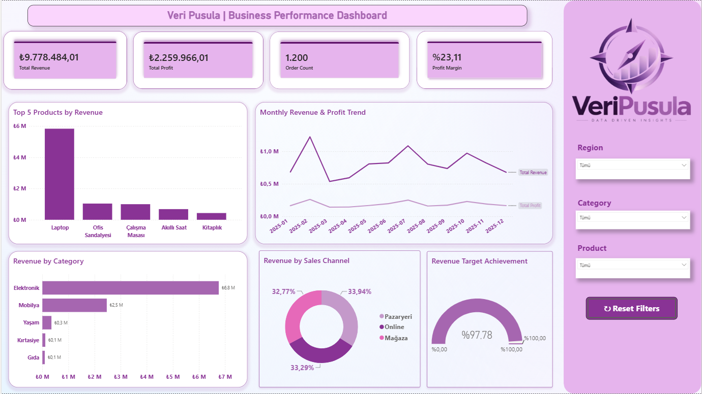
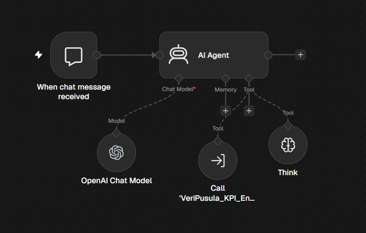
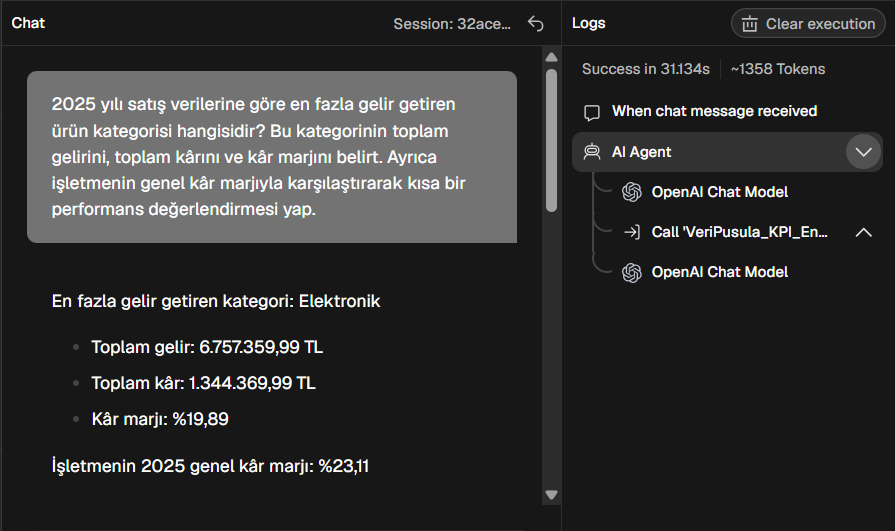
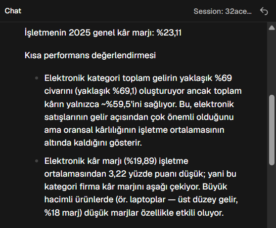
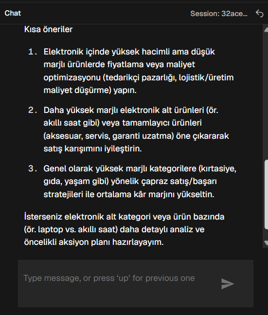

# VeriPusula

**Yapay zekâ destekli işletme performans ve karar destek asistanı**

VeriPusula; satış verilerini Python ile temizleyen, SQLite ve SQL ile analiz eden, Power BI ile görselleştiren ve n8n üzerinden doğal dilde sorulara yanıt sunan bir portföy projesidir.

Proje, 2025 yılına ait **1.200 sentetik sipariş** üzerinde geliştirilmiştir. Gerçek bir şirketin verilerini veya performansını temsil etmez.

## Kullanılan teknolojiler

| Teknoloji | Projedeki görevi |
|---|---|
| Python / Pandas | Veri temizleme, doğrulama ve gelir-kâr hesaplamaları |
| SQLite / SQL | Verilerin saklanması ve KPI analizleri |
| Power BI / DAX | Etkileşimli dashboard ve performans ölçüleri |
| n8n / AI Agent | Araç kullanarak satış verileri hakkında soru-cevap |

## Projenin aşamaları

1. **ETL:** Ham CSV okunur; tarih ve sayısal alanlar dönüştürülür. Eksik, geçersiz ve yinelenen sipariş kayıtları elenir. Gelir ve kâr hesaplanır.
2. **Veritabanı ve SQL:** Temiz veriler SQLite içindeki `sales` tablosuna yazılır. Genel KPI'lar, kategori, ay, bölge, satış kanalı ve ürün performansı sorgulanır.
3. **Power BI:** Gelir, kâr, sipariş sayısı ve kâr marjı; grafikler ve dilimleyiciler aracılığıyla incelenir.
4. **n8n AI Assistant:** Ana asistan, `VeriPusula_KPI_Engine` alt iş akışını çağırır. Alt iş akışı Data Table içindeki 1.200 satış kaydını alır ve Python Code adımında özetler. Asistan, araç çıktısına dayanarak yanıt üretir.

**Entegrasyon notu:** n8n aşaması verilerin Data Table'a aktarılmış kopyasını kullanır. SQLite ile otomatik ve canlı senkronizasyon bu sürümde uygulanmamıştır.

## Örnek sonuçlar

| KPI | Değer |
|---|---:|
| Sipariş sayısı | 1.200 |
| Toplam gelir | 9.778.484,01 TL |
| Toplam kâr | 2.259.966,01 TL |
| Kâr marjı | %23,11 |
| En yüksek gelirli kategori | Elektronik |

Elektronik kategorisinin geliri **6.757.359,99 TL**, kârı **1.344.369,99 TL**, kâr marjı **%19,89** olarak hesaplanmıştır.

## Dosyalar ve klasörler

Aşağıdaki yapı, depo için önerilen yerleşimdir. Dashboard, ekran görüntüleri ve n8n dışa aktarımları ilgili klasörlere ayrıca eklenir.

| Yol | İçerik |
|---|---|
| `etl.py` | Python ETL kodu |
| `requirements.txt` | Python bağımlılıkları |
| `data/sales_data.csv` | Ham sentetik veri |
| `data/clean_sales_data.csv` | Temizlenmiş veri ve hesaplanan alanlar |
| `data/veripusula.db` | SQLite veritabanı |
| `sql/kpi_queries.sql` | SQLite analiz sorguları |
| `powerbi/` | Power BI rapor dosyası |
| `n8n/` | Ana asistan ve KPI Engine workflow JSON dosyaları |
| `screenshots/` | Dashboard ve asistan demo ekran görüntüleri |

## ETL kurulumu ve çalıştırma

Python ve Pandas gereklidir. Depoyu indirdikten sonra proje klasöründe terminal açın:

```powershell
python -m pip install -r requirements.txt
```

`requirements.txt` yoksa Pandas kurulumu için:

```powershell
python -m pip install "pandas<3.0"
```

### Dosya yolları

ETL, ham veriyi data/ klasöründen okur; temiz CSV ve SQLite veritabanını aynı klasörde oluşturur.

```python
BASE = Path(__file__).resolve().parent
DATA = BASE / "data"
DATA.mkdir(parents=True, exist_ok=True)
INPUT = DATA / "sales_data.csv"
OUTPUT = DATA / "clean_sales_data.csv"
DB = DATA / "veripusula.db"
```

`data/sales_data.csv` mevcutken çalıştırın:

```powershell
python etl.py
```

Windows'ta `python` tanınmıyorsa `py` komutunu deneyin.

ETL, temiz CSV'yi üretir ve veritabanındaki `sales` tablosunu yeniden oluşturur. Beklenen konsol çıktısı:

```text
ETL complete | Orders: 1200 | Total Revenue: 9,778,484.01 TRY | Total Profit: 2,259,966.01 TRY
```

## KPI hesaplamaları

- **Gelir:** `quantity * unit_price * (1 - discount_rate)`
- **Toplam maliyet:** `quantity * unit_cost`
- **Kâr:** `revenue - total_cost`
- **Kâr marjı (%):** `100 * SUM(profit) / SUM(revenue)`
- **Sipariş sayısı:** Benzersiz `order_id` sayısı; temiz veride her satır bir sipariştir.

Gelir ve maliyet satır bazında iki ondalığa yuvarlanır. İndirim satış fiyatına uygulanır. Kâr marjı, satır marjlarının ortalaması alınarak hesaplanmaz.

## SQL analizleri

SQLite destekleyen bir uygulama `data/veripusula.db` dosyasını açın ve `sql/kpi_queries.sql` içindeki sorguları ayrı ayrı çalıştırın.

Sorgu dosyası; genel KPI'ları, kategori ve aylık performansı, bölge ve satış kanalı analizlerini, en yüksek gelirli 10 ürünü ve 2025'in en yüksek/düşük gelirli aylarını içerir. Verileri değiştirmez.

## Power BI dashboard

`data/clean_sales_data.csv` dosyası Power BI'a alınarak gelir, kâr ve kategori performansı görselleştirilmiştir. Dilimleyiciler sayesinde tarih, kategori ve bölge bazında inceleme yapılabilir.

CSV içe aktarılırken tarih ve sayısal sütunların veri türleri ile ondalık ayarları kontrol edilmelidir. Bu projedeki mevcut Power BI modelinde `profit` alanı içe aktarım sırasında 100 kat büyük geldiği için `[Total Profit]` ölçüsünde 100'e bölme düzeltmesi kullanılmıştır. Bu düzeltme CSV veya SQLite verisine uygulanmamalıdır; yeni bir Power BI modelinde önce içe aktarılan değerler doğrulanmalıdır.

## n8n demo

Asistana sorulabilecek örnekler:

- 2025 yılında en fazla gelir getiren kategori hangisi?
- Elektronik kategorisinin toplam geliri, kârı ve kâr marjı nedir?
- 2025'te en yüksek ve en düşük satış geliri hangi aylarda gerçekleşti?

Workflow dosyaları, iş akışlarının yapısını paylaşmak içindir. Başka bir n8n ortamına aktarılırken model bağlantısı, Data Table seçimi ve alt iş akışı referansları yeniden yapılandırılmalıdır. Workflow JSON dosyaları tek başına Data Table'daki satış kayıtlarını taşımaz; veriler ayrıca içe aktarılmalıdır.

API anahtarları ve şifreler depoya eklenmemelidir. Paylaşılan workflow dosyaları gizli bilgiler, özel bağlantılar ve kaydedilmiş örnek veriler açısından kontrol edilmelidir.

## Sınırlar

- Veriler sentetiktir; sonuçlar gerçek bir şirket hakkında çıkarım yapmak için kullanılamaz.
- Dashboard ve asistan, kullanılan veri kopyalarının güncelliğine bağlıdır.
- Asistanın sayısal yanıtları SQL veya dashboard sonuçlarıyla karşılaştırılarak doğrulanmalıdır.
- Proje, tahminleme veya satış değişimlerinin nedenlerini kanıtlama iddiası taşımaz.

## Proje Görselleri

### Power BI Dashboard


### n8n İş Akışı


### AI Asistan Demo



